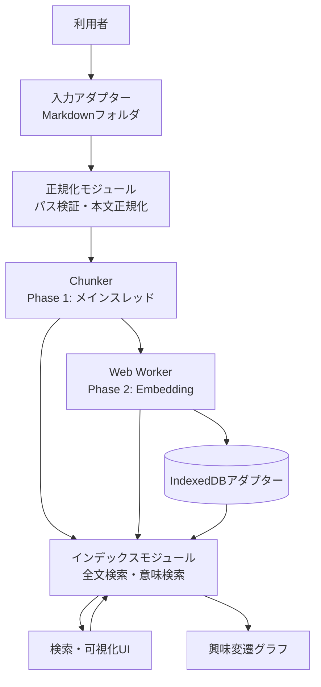

# Local Semantic Memory 基本設計書（ドラフト）

## 1. 概要と基本方針

### 1.1 目的と対象範囲

Local Semantic Memoryは、利用者が選択したローカルMarkdownフォルダ、ブラウザ履歴、ブックマークを、ブラウザ内だけで検索・分析する個人向けアプリケーションである。検索結果と入力データの時系列を用いて、利用者の興味関心の変化を可視化する。

- **対象範囲**: データ読込、正規化、チャンク化、全文検索、意味検索、ローカル永続化、トピック集計・表示。
- **対象外範囲**: サーバー同期、利用者認証、履歴の自動取得、サーバー側Embedding、共有機能。
- **プライバシー原則**: 入力データ、Embedding、検索語を外部サーバーへ送信しない。
- **実行形態**: ローカルHTMLをブラウザで開いて動作する形を基本とする。
- **開発環境制約**: Node.jsは利用できないため、初期設計・初期実装ではNode.jsコマンドを実行しない。配布方式はビルド不要のJavaScriptを第一候補とする。

### 1.2 技術方針（未確定部分を含む）

| 領域                 | ドラフト方針                                                                                          | 状態     |
| :------------------- | :---------------------------------------------------------------------------------------------------- | :------- |
| 記述言語             | TypeScriptを主言語とし、初期実行は`// @ts-check`付きJavaScriptも許容する                              | 採用候補 |
| 配布                 | ビルド不要のHTML + JavaScript + CDN（esm.sh）を第一候補とする                                         | 未確定   |
| 型検証               | Zod相当のスキーマ検証を入力境界に置く                                                                 | 未確定   |
| Markdown             | File System Access APIで選択したフォルダから読む                                                      | 採用候補 |
| バックグラウンド処理 | Web Workerにチャンク化・Embeddingを分離する                                                           | 採用候補 |
| 全文検索             | Phase 1は日本語3-gram、Phase 2はキーワード順位とベクトル順位をRRFで統合する検索モジュールを候補とする | 未確定   |
| Embedding            | Transformers.jsのmultilingual-e5-small相当を候補とする                                                | 未確定   |
| 永続化               | Phase 2以降、IndexedDBに検索データとEmbeddingキャッシュを保存する                                     | 採用候補 |
| 可視化               | ブラウザ内のグラフ描画手段を採用する                                                                  | 未確定   |

## 2. システム構成

### 2.1 モジュール責務

| ID    | モジュール       | 主な責務                                                                                      | 外部Seam / Adapter                           |
| :---- | :--------------- | :-------------------------------------------------------------------------------------------- | :------------------------------------------- |
| M-001 | Input Adapter    | File System Access APIまたはドロップデータを統一入力へ変換する                                | `FileSystemInputAdapter`、`DropInputAdapter` |
| M-002 | Normalizer       | Phase 1ではMarkdownのパス検証、本文・タイトル・日時の正規化を行う。URL除外はPhase 2で扱う     | `SchemaValidator`、`PathValidator`           |
| M-003 | Chunker          | Phase 1のメインスレッドでSourceDocumentの本文をチャンクへ分割する                             | 純粋な分割処理とハッシュAdapterを分離        |
| M-004 | Embedding Worker | UIを止めずにEmbeddingを生成する                                                               | `WorkerAdapter`、テスト用同期Adapter         |
| M-005 | Search Index     | Phase 1では日本語n-gramによる全文検索、Phase 2ではキーワード順位とベクトル順位をRRFで統合する | `SearchIndexAdapter`、`VectorSearchAdapter`  |
| M-006 | Memory Store     | IndexedDBへの保存、読込、削除、再構築を扱う                                                   | `IndexedDbAdapter`、テスト用InMemoryAdapter  |
| M-007 | Topic Analyzer   | Embeddingをクラスタリングし月次集計を作る                                                     | `ClusterAdapter`                             |
| M-008 | Presentation     | 検索条件、進捗、結果、グラフを表示する                                                        | DOM描画Adapter                               |

### 2.2 深いモジュールとSeam

検索UIは「入力を渡して検索結果を受け取る」小さなInterfaceだけを知る。検索方式、インデックス更新、Embedding再利用、エラー分類はSearch IndexのImplementationへ隠蔽する。IndexedDBやWeb WorkerはAdapterとして差し替え可能にし、ブラウザAPIをUIへ漏らさない。

- **外部Seam**: `SearchIndex`、`MemoryStore`、`EmbeddingProvider`のInterface。
- **内部Seam**: チャンク化、正規化、クラスタリングの純粋関数境界。
- **Production Adapter**: IndexedDB、Web Worker、ブラウザFile API。
- **Test Adapter**: インメモリストア、同期Embedding、固定検索結果。
- **Depthの狙い**: UI側がデータ保存・ベクトル計算・検索方式の詳細を持たず、変更を各モジュール内へ局所化する。

## 3. 処理フロー

1. 利用者がMarkdownフォルダを選択する。
2. Input Adapterがファイルを読み、Normalizerが入力形式を検証する。
3. Normalizerが親参照・絶対パス、空データを除外する。URLスキームや履歴・ブックマークのノイズ除外はPhase 2で扱う。
4. ChunkerがSourceDocumentを見出し単位・約500文字を目安にMemoryChunkへ分割する。
5. Phase 1ではMemoryChunkをメモリ上のn-gram全文検索インデックスへ登録する。IndexedDBには保存せず、リロード時に再構築する。
6. Phase 2ではWorkerがEmbeddingを生成し、Memory StoreへDocument・Chunk・Embeddingを保存する。
7. Phase 2のSearch Indexはキーワード順位とベクトル順位をReciprocal Rank Fusion（RRF）で統合する。
8. UIがキーワード検索または意味検索をSearch Indexへ依頼する。
9. Topic Analyzerが検索対象の時系列データを月別・トピック別に集計する。
10. Presentationが検索結果と興味変遷グラフを表示する。

## 4. 検索方式と規模方針

### 4.1 Phase 1の全文検索

- 日本語を含む入力では、初期実装として文字n-gramを使う。既定値は3-gramとし、設定値として変更可能にする。
- 検索対象は`title`、`body`、`sourceLocator`の正規化済みテキストとする。
- Phase 1のインデックスはメモリ上だけに保持する。リロード後は入力データから再構築する。
- Orama等の採用は、日本語n-gramを明示的に設定できることを確認してから決定する。

### 4.2 Phase 2の意味検索と統合

- EmbeddingはMemoryChunk単位で生成する。
- ベクトル検索は、当初は対象件数を絞ったメモリ上の総当たりコサイン類似度で実装する。
- キーワード順位とベクトル順位の統合にはRRFを使用する。順位`r`に対する寄与は`1 / (k + r)`とし、`k`の初期値は60とする。
- ベクトル検索の対象は初期上限50,000チャンクとする。超過時は期間・ソース・検索条件による絞り込みを要求し、黙って切り捨てない。
- 384次元のFloat32ベクトルは1チャンクあたり約1.5 KiBと見積もる。50,000チャンクではベクトル本体だけで約73 MiBとなるため、実装時にブラウザメモリを測定し上限を調整する。

### 4.3 検索方式の重複管理

全文検索インデックスはキーワード検索を担当し、Embedding Cacheはベクトル検索を担当する。Orama等がベクトル検索機能を持つ場合でも、Embeddingの生成元・モデル識別子・キャッシュの正本はEmbedding Cacheに統一し、二重保存しない。

## 5. システム境界と安全方針

- ブラウザ外への通信は、利用するCDNからのライブラリ・モデル取得を除き行わない。CDN利用を許可しない環境では、配布方式を再検討する。
- 入力ファイルは利用者が明示的に選択したものだけを処理する。
- IndexedDBのデータは利用者のブラウザプロファイル内に保存し、削除・全再構築操作を提供する。
- 外部入力のURL、タイトル、本文は表示時にHTMLとして解釈せず、テキストとして扱う。
- Embeddingモデルの取得元、モデルのライセンス、初回ダウンロードサイズは実装前に確認する。
- 検索・Embedding処理の失敗時も、既存のIndexedDBデータを破壊しない。

## 6. フェーズと完了条件

| フェーズ | 実装範囲                                           | 完了条件                                            |
| :------- | :------------------------------------------------- | :-------------------------------------------------- |
| Phase 1  | Markdownフォルダ読込、正規化、チャンク化、全文検索 | `.md`を読み込み、キーワードで結果を表示できる       |
| Phase 2  | Web Worker、Embedding、IndexedDB                   | 意味検索ができ、リロード後にEmbeddingを再計算しない |
| Phase 3  | クラスタリング、トピック命名、月次グラフ           | 数ヶ月から数年の関心変化をグラフで確認できる        |

## 7. 未決事項

- CDN依存を許容する配布環境と、オフライン配布時の代替方式。
- Node.jsなしでTypeScriptをどの段階まで記述・検証するか。
- 対応する履歴・ブックマークの入力形式と最大サイズ。
- Embeddingモデルの取得元、ライセンス、キャッシュ方式。
- 検索結果の関連度評価とクラスタリング品質の評価方法。
