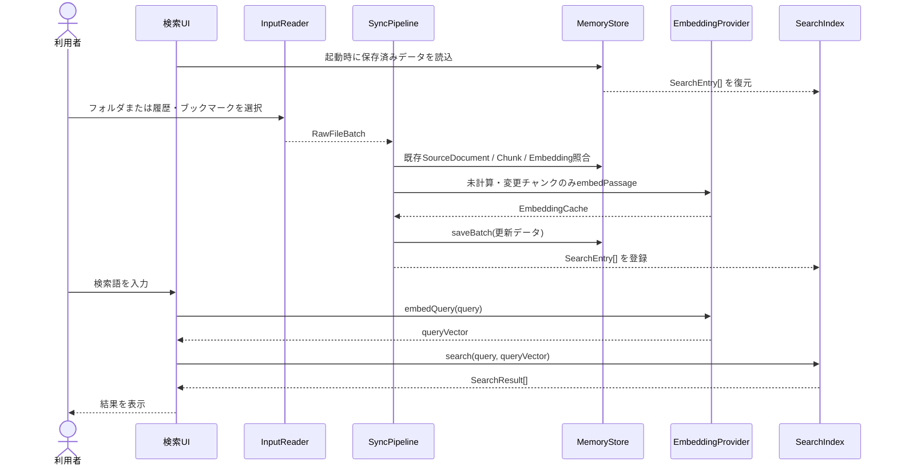

# Local Semantic Memory 詳細設計書（ドラフト）

## 1. 対象範囲

本書は、Markdown・履歴・ブックマーク入力の正規化、検索用チャンク生成、Embedding生成、IndexedDBへの差分保存、およびキーワード順位とベクトル順位をReciprocal Rank Fusion（RRF）で統合する検索モジュール契約を正本とする。Topicクラスタリングと月次グラフはPhase 3の詳細設計で定義する。

### 1.1 対象機能

- Markdownフォルダの読み込み（フォルダ内の`.md`ファイルを対象とする）
- 履歴・ブックマークエクスポートファイル（JSON / HTML）および単一Markdownファイルの読み込み（Phase 2）
- 相対パス検証および履歴・ブックマークのURLスキーム除外（Phase 2）
- 見出し・文字数単位のチャンク分割とSHA-256ハッシュ算出
- `passage: ` / `query: `接頭辞を付与するEmbedding生成とWeb Workerアダプター境界（Phase 2）
- IndexedDBおよびインメモリストアによる`SourceDocument`・`MemoryChunk`・`EmbeddingCache`の差分保存と再利用（Phase 2）
- 日本語3-gram・2-gram全文検索とコサイン類似度ベクトル検索のRRFハイブリッド検索（Phase 2）
- 入力、正規化、Embedding、永続化、検索で発生するエラーの分類と状態保全

### 1.2 対象外

- Topicクラスタリング、トピック命名、月次興味変遷グラフ（Phase 3）
- 外部サーバーとのデータ同期・認証

## 2. モジュールInterface

### 2.0 データ型

| 型名                 | 主なフィールド・定義                                                                                                               |
| :------------------- | :--------------------------------------------------------------------------------------------------------------------------------- |
| `SourceType`         | `"markdown"` / `"history"` / `"bookmark"`                                                                                          |
| `RawFile`            | `path`, `title`, `body`, `updatedAt`, `sourceType?`, `sourceTimestampKind?`                                                        |
| `SourceDocument`     | `sourceId`, `sourceType`, `sourceLocator`, `title`, `body`, `sourceTimestamp`, `sourceTimestampKind`, `sourceHash`, `schemaVersion` |
| `MemoryChunk`        | `chunkId`, `sourceId`, `ordinal`, `body`, `contentHash`, `charStart`, `charEnd`, `schemaVersion`                                   |
| `EmbeddingCache`     | `chunkId`, `modelId`, `dimensions`, `vector`, `generatedAt`                                                                        |
| `SearchEntry`        | `chunk`, `source`, `embedding?`                                                                                                    |
| `SearchOptions`      | `sourceIds?`, `sourceTypes?`, `updatedAfter?`, `updatedBefore?`, `queryVector?`, `rrfK?`                                           |
| `Result<T, E>`       | `{ ok: true, value: T }` または `{ ok: false, error: E }`                                                                          |
| `NormalizeError`     | `"PATH_INVALID"` / `"URL_EXCLUDED"` / `"DOCUMENT_EMPTY"`                                                                           |
| `EmbeddingError`     | `"EMBEDDING_EMPTY"` / `"EMBEDDING_INVALID_VECTOR"` / `"EMBEDDING_FAILED"`                                                          |
| `StoreError`         | `"STORE_READ_FAILED"` / `"STORE_WRITE_FAILED"` / `"STORE_CLEAR_FAILED"`                                                            |
| `IndexError`         | `"INDEX_SIZE_LIMIT"` / `"INDEX_BUILD_FAILED"`                                                                                      |
| `SearchError`        | `"QUERY_EMPTY"` / `"SEARCH_FAILED"`                                                                                                |

### 2.1 InputReader

**責務**: 利用者が選択またはドロップした入力を読み取り、ファイル・レコード単位の未加工データを返す。

- `readMarkdownDirectory(directory: FileSystemDirectoryHandle): Promise<InputReadResult>`
- `parseStructuredExport(fileName: string, content: string, fallbackUpdatedAt?: number): Result<RawFile[], FileReadError>`
- `readInputFiles(files: Iterable<File>): Promise<RawFileBatch>`

**契約**:

- InputReaderは選択済みの`FileSystemDirectoryHandle`または`File`一覧を受け取り、ディレクトリ列挙失敗を`DirectoryReadError`として返す。
- Markdownフォルダ走査時は`.md`以外のファイルを対象外とする。
- ファイル入力時は`.md`をMarkdown、`.json`および`.html`を履歴・ブックマークエクスポートとして解析する。
- 個別ファイルの読み取りまたは形式解析に失敗した場合は`FileReadError`（相対`path`と安全な`message`を含む）を`failures`へ追加し、他ファイルの処理は継続する。
- UIは成功件数、失敗件数、失敗ファイル名を表示する。

### 2.2 Normalizer

**責務**: RawFileを検証し、SourceDocumentを生成する。

- `normalize(raw: RawFile, hasher: Hasher): Promise<Result<SourceDocument, NormalizeError>>`

**契約**:

- Markdownでは`sourceId`を`markdown:`と正規化相対パスから生成し、`..`による親参照、Windowsドライブ指定、UNCパス、制御文字を含むパスは`PATH_INVALID`として拒否する。
- 履歴（`history`）とブックマーク（`bookmark`）では、`http:`または`https:`以外のURLスキーム（`javascript:`、`data:`、`file:`、`chrome:`、`about:`等）および不正URLを`URL_EXCLUDED`として拒否する。
- 履歴の`sourceId`は同一URLへの複数訪問を区別するため`history:${sourceLocator}:${sourceTimestamp}`とし、`sourceTimestampKind`は`"visited"`とする。
- ブックマークの`sourceId`は`bookmark:${sourceLocator}`とし、`sourceTimestampKind`は`"created"`とする。
- `sourceHash`は、正規化済み`sourceLocator`と入力本文をLFで連結した値のSHA-256とする。
- 空タイトルはファイル名またはURL末尾・ホスト名から補完し、本文が空の場合は`DOCUMENT_EMPTY`として除外する。

### 2.3 Chunker

**責務**: SourceDocumentの本文を検索単位へ分割する。

- `chunk(source: SourceDocument, hasher: Hasher): Promise<MemoryChunk[]>`

**契約**:

- Markdown見出しを優先的な分割位置とし、1チャンクの目安は約500文字とする。
- 長い段落は文字境界で分割する。
- `ordinal`はSourceDocumentごとの0始まり連番とし、`chunkId`は`${sourceId}:${ordinal}`から決定的に生成する。
- 空白だけのチャンクは生成しない。
- `contentHash`はHasher Adapterで算出するため、Chunkerはブラウザの暗号APIを直接呼び出さない。

### 2.4 EmbeddingProvider / WorkerAdapter

**責務**: チャンク本文および検索クエリからEmbeddingベクトルを非同期生成する。

- `embedPassage(text: string): Promise<Result<number[], EmbeddingError>>`
- `embedQuery(text: string): Promise<Result<number[], EmbeddingError>>`

**契約**:

- EmbeddingProviderは文書入力へ`passage: `、検索クエリ入力へ`query: `接頭辞を内部で付与する。呼び出し側は接頭辞を直接付与しない。
- 空文字列の入力は`EMBEDDING_EMPTY`を返す。
- 生成されたベクトルの次元数が`dimensions`と一致しない場合、または非有限値（`NaN` / `Infinity`）を含む場合は`EMBEDDING_INVALID_VECTOR`を返す。
- UIスレッドをブロックしないようWeb Worker経由または非同期バッチ境界で実行し、テスト時は同期・決定論的Adapterへ差し替え可能にする。

### 2.5 MemoryStore

**責務**: `SourceDocument`、`MemoryChunk`、`EmbeddingCache`の永続化、差分更新、全削除を担う。

- `loadAll(): Promise<Result<StoredSnapshot, StoreError>>`
- `saveBatch(snapshot: StoredSnapshot): Promise<Result<void, StoreError>>`
- `deleteSource(sourceId: string): Promise<Result<void, StoreError>>`
- `clearAll(): Promise<Result<void, StoreError>>`
- `syncRawFilesToStore(rawFiles: RawFile[], store: MemoryStore, hasher: Hasher, embeddingProvider: EmbeddingProvider): Promise<Result<SyncSummary, StoreError>>`

**契約**:

- 同一`sourceId`かつ同一`sourceHash`の保存済み`SourceDocument`が存在する場合、再チャンク化を行わず既存チャンクを再利用する。
- 同一`chunkId`かつ同一`contentHash`の保存済みチャンクに対し、同一`modelId`の`EmbeddingCache`が存在する場合、Embeddingを再計算せず再利用する。
- `modelId`または`contentHash`が変化したチャンクのみEmbeddingを再生成する。
- 保存失敗時は更新前のストア状態を維持し、`STORE_WRITE_FAILED`を返す。
- `deleteSource`は対象の`SourceDocument`に紐づく`MemoryChunk`と`EmbeddingCache`を連鎖削除する。

### 2.6 SearchIndex

**責務**: MemoryChunkとEmbeddingの登録、削除、キーワード検索およびRRFハイブリッド検索をメモリ上で行う。

- `create(): SearchIndex`
- `add(entries: SearchEntry[]): Result<void, IndexError>`
- `clear(): void`
- `search(query: string, options?: SearchOptions): Result<SearchResult[], SearchError>`

**契約**:

- 登録対象は`source.title`、`chunk.body`、`source.sourceLocator`を連結した検索テキストと任意の`embedding`とする。
- 日本語検索は3-gramと2-gramを登録時に併用する。3文字以上の検索語は3-gram、2文字は2-gram、1文字は走査による部分一致へ分岐する。
- `options.queryVector`が指定された場合、キーワード検索順位`r_k`とコサイン類似度によるベクトル検索順位`r_v`をRRF（`1 / (k + r)`、既定値`k = 60`）で統合したスコアを算出する。
- `options.sourceIds`、`options.sourceTypes`、`options.updatedAfter`、`options.updatedBefore`による絞り込みを適用する。
- 結果はスコア降順、同点時は`sourceTimestamp`降順、さらに`chunkId`昇順で安定ソートする。
- 50,000チャンクを超える場合は状態を変更せず`INDEX_SIZE_LIMIT`を返し、部分登録は行わない。

### 2.7 SearchResult

| フィールド        | 型     | 必須  | 内容                                       |
| :---------------- | :----- | :---: | :----------------------------------------- |
| `chunkId`         | string | 必須  | MemoryChunkの識別子                        |
| `sourceId`        | string | 必須  | SourceDocumentの識別子                     |
| `title`           | string | 必須  | 表示用タイトル                             |
| `snippet`         | string | 必須  | 一致箇所を含む本文抜粋                     |
| `sourceLocator`   | string | 必須  | 表示用の相対パスまたはURL                  |
| `sourceTimestamp` | number | 必須  | 更新・閲覧・登録時刻                       |
| `score`           | number | 必須  | キーワード検索またはRRF統合による検索スコア |

## 3. 制御フロー

### 3.1 起動時復元と差分同期

1. 起動時にUIがMemoryStoreから保存済み`SourceDocument`、`MemoryChunk`、`EmbeddingCache`を読み込み、SearchIndexを構築する。
2. 利用者が新しいフォルダまたは履歴・ブックマークファイルを読み込ませた際、`sourceHash`と`contentHash`を照合し、未変更のチャンクは保存済み`EmbeddingCache`を再利用する。
3. 同期完了後、既存画面の古い検索結果リストをクリアし、成功件数・再利用件数・失敗ファイル名・除外件数を表示する。

### 3.2 データ削除と再構築

- 利用者が「保存データを削除」を実行した場合、MemoryStoreとSearchIndexを両方クリアし、初期状態へ戻す。
- 検索または永続化エラーが発生した場合、既存のSearchIndexとMemoryStoreの状態を破壊しない。

## 4. エラー分類

| コード                     | 種別      | 発生条件                     | UIの扱い                                 |
| :------------------------- | :-------- | :--------------------------- | :--------------------------------------- |
| `DIRECTORY_READ_FAILED`    | 入力      | ディレクトリ列挙に失敗       | 読み込みを終了し再試行を表示             |
| `FILE_READ_FAILED`         | 入力      | 個別ファイルの読取・解析失敗 | 対象ファイル名を表示し他ファイルを継続   |
| `PATH_INVALID`             | 正規化    | 親参照・絶対パスなどを検出   | 対象ファイルを除外し通知する             |
| `URL_EXCLUDED`             | 正規化    | 非HTTP/HTTPSや不正URLを検出  | 対象レコードを除外し通知する             |
| `DOCUMENT_EMPTY`           | 正規化    | 本文が空                     | 対象Documentを検索対象外にする           |
| `EMBEDDING_EMPTY`          | Embedding | 空テキストのベクトル化要求   | 対象チャンクのベクトル生成をスキップ     |
| `EMBEDDING_INVALID_VECTOR` | Embedding | 次元不一致または非有限値     | 更新前の状態を維持しエラーを通知         |
| `EMBEDDING_FAILED`         | Embedding | モデル推論またはWorker失敗   | 更新前の状態を維持しエラーを通知         |
| `STORE_READ_FAILED`        | 永続化    | IndexedDBからの読込失敗      | メモリインデックスで継続し警告を表示     |
| `STORE_WRITE_FAILED`       | 永続化    | IndexedDBへの保存失敗        | 既存データを維持し再試行を案内           |
| `STORE_CLEAR_FAILED`       | 永続化    | IndexedDBの全削除失敗        | エラーを表示し再試行を案内               |
| `INDEX_SIZE_LIMIT`         | 検索      | 50,000チャンク超過           | フォルダまたは登録対象を絞って再実行する |
| `INDEX_BUILD_FAILED`       | 検索      | インデックス登録に失敗       | 更新前の状態を保持し再試行を案内         |
| `QUERY_EMPTY`              | 検索      | 検索語が空                   | 検索を実行せず入力を促す                 |
| `SEARCH_FAILED`            | 検索      | 検索処理に失敗               | インデックスを破棄せず再構築を案内       |

- `path`は選択ルートからの相対パスまたはファイル名のみを保持し、ドライブ名、UNCパス、ユーザー名、絶対パスを含めない。
- `message`は固定された安全な説明文とし、入力本文、完全パス、URL、検索語、認証情報を含めない。

## 5. 非機能目標（初期値）

| ID      | 目標         | 暫定値                                                    | 測定方法                        |
| :------ | :----------- | :-------------------------------------------------------- | :------------------------------ |
| NFR-001 | 初期検索応答 | 50,000チャンク以内で通常検索の結果を1秒以内に返す         | ブラウザのPerformance APIで計測 |
| NFR-002 | UI応答性     | 10,000チャンクまで初期登録中に操作不能時間を2秒以内にする | ブラウザ上で計測                |
| NFR-003 | データ保全   | 検索・保存失敗で既存のインデックスと永続化データを破棄しない | エラー時の状態確認              |
| NFR-004 | キャッシュ効率 | 同一`sourceHash`・`contentHash`・`modelId`の再読込でEmbedding再計算0件 | 差分同期テストで確認            |

## 6. Phase 2の完了条件

- Markdownフォルダに加え、履歴・ブックマークファイルを読み込み、`SourceDocument`へ正規化できる。
- `http:` / `https:`以外のURLスキームを`URL_EXCLUDED`として除外できる。
- `EmbeddingProvider`が文書へ`passage: `、検索クエリへ`query: `接頭辞を付与してベクトルを生成できる。
- `MemoryStore`（IndexedDBおよびInMemory Adapter）へ`SourceDocument`、`MemoryChunk`、`EmbeddingCache`を保存・復元・全削除できる。
- リロード後や再読み込み時に、同一`sourceHash` / `contentHash` / `modelId`のEmbeddingを再計算せず再利用できる。
- キーワード検索順位とベクトル検索順位をRRF（`k = 60`）で統合したハイブリッド検索ができる。
- 50,000チャンク上限とトランザクション失敗時の既存データ保全を満たす。

## 7. 後続設計（Phase 3）への引継ぎ

- Embeddingを用いたTopicクラスタリング
- クラスタ代表語によるトピック命名
- `sourceTimestamp`と`sourceTimestampKind`に基づく月次興味変遷グラフ表示
