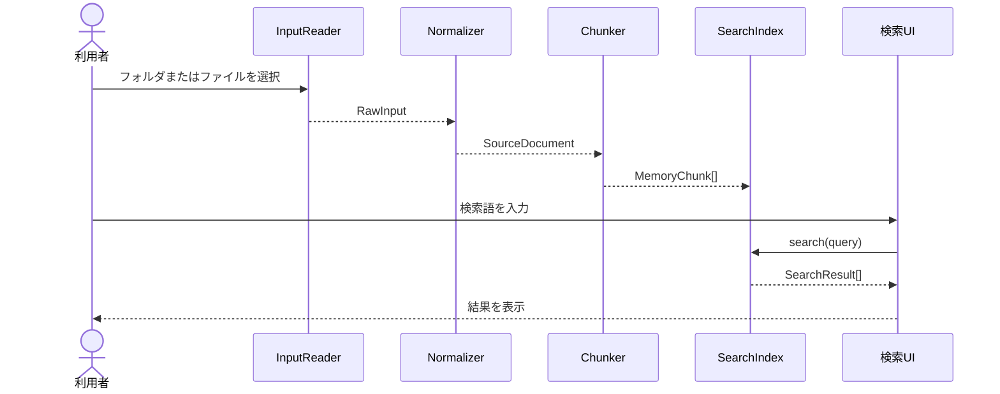

# Local Semantic Memory 詳細設計書（ドラフト）

## 1. 対象範囲

本書は、入力データを正規化し、検索用チャンクを生成し、メモリ上の全文検索インデックスから結果を返すモジュール契約を正本とする。Embedding、IndexedDB、RRF統合、クラスタリングは後続の設計で定義する。

### 1.1 対象機能

- Markdownフォルダ・ファイルの読み込み
- 履歴・ブックマーク入力の形式検証
- `SourceDocument`への正規化
- `MemoryChunk`への分割
- 日本語3-gram全文検索
- 検索結果の整形
- 入力・検索エラーの分類

### 1.2 対象外

- Web Workerへの処理移行
- Embedding生成と`query:` / `passage:`接頭辞
- IndexedDBへの保存と再利用
- RRFによるハイブリッド検索
- Topicクラスタリングと月次グラフ
- Node.js、Bun、npmを使ったビルド・テスト実行

## 2. モジュールInterface

### 2.1 InputReader

**責務**: 利用者が選択した入力を読み取り、ファイル単位の未加工データを返す。

```text
readMarkdownDirectory(): Promise<RawFile[]>
readDroppedFile(file: File): Promise<RawFile>
```

**契約**:

- 利用者の明示操作なしにファイルを読み取らない。
- `.md`以外のMarkdownフォルダ内ファイルは初期対象外とする。
- 読み取り失敗は`INPUT_READ_FAILED`として返す。
- 入力本文をログへ出力しない。

### 2.2 Normalizer

**責務**: RawFileまたは履歴・ブックマークレコードを検証し、SourceDocumentを生成する。

```text
normalize(raw: RawInput): Result<SourceDocument, NormalizeError>
```

**契約**:

- `sourceId`は入力元種別と正規化ロケーターから安定生成する。
- `sourceType`は`markdown`、`history`、`bookmark`のいずれかに限定する。
- Markdownの日時は`sourceTimestampKind=updated`とする。
- 履歴の日時は`sourceTimestampKind=visited`とする。
- ブックマークの日時は`sourceTimestampKind=created`とする。
- 空タイトルはファイル名またはURLから補完し、本文が空の場合は検索対象外とする。
- 不正レコードは全処理を中断せず、レコード単位で除外して警告へ集計する。

### 2.3 Chunker

**責務**: SourceDocumentの本文を検索単位へ分割する。

```text
chunk(source: SourceDocument): MemoryChunk[]
```

**契約**:

- Markdown見出しを優先的な分割位置とする。
- 1チャンクの目安は500文字前後とする。
- 長い段落は文字境界で分割する。
- `ordinal`はSourceDocumentごとの0始まり連番とする。
- `chunkId`は`sourceId + ordinal`から決定的に生成する。
- 空白だけのチャンクは生成しない。
- 同一入力に対して同じ順序・同じ本文を返す純粋な処理とする。

### 2.4 SearchIndex

**責務**: MemoryChunkの登録、削除、検索をメモリ上で行う。

```text
create(): SearchIndex
add(chunks: MemoryChunk[]): void
clear(): void
search(query: string, options?: SearchOptions): SearchResult[]
```

**契約**:

- Phase 1ではIndexedDBや外部サービスへアクセスしない。
- 登録対象は`title`、`body`、`sourceLocator`を連結した検索テキストとする。
- 日本語検索は3-gramを基本とし、検索語も同じ正規化・分割を適用する。
- ASCII単語は小文字化し、Unicode正規化を適用する。
- 結果はスコア降順、同点時は`sourceTimestamp`降順、さらに`chunkId`昇順で安定ソートする。
- 空検索語は検索せず、利用者へ入力を促す。
- 初期のメモリ上限は50,000チャンクとし、超過時は`INDEX_SIZE_LIMIT`を返す。

### 2.5 SearchResult

| フィールド        | 型     | 必須  | 内容                            |
| :---------------- | :----- | :---: | :------------------------------ |
| `chunkId`         | string | 必須  | MemoryChunkの識別子             |
| `sourceId`        | string | 必須  | SourceDocumentの識別子          |
| `title`           | string | 必須  | 表示用タイトル                  |
| `snippet`         | string | 必須  | 一致箇所を含む本文抜粋          |
| `sourceLocator`   | string | 必須  | 表示用の相対パスまたはURL       |
| `sourceTimestamp` | number | 必須  | 元データの時刻                  |
| `score`           | number | 必須  | 3-gram一致に基づくPhase 1スコア |

## 3. 制御フロー



### 3.1 初期化

1. UIがInputReaderへ読み込みを依頼する。
2. 入力ごとにNormalizerを実行する。
3. 正常なSourceDocumentをChunkerへ渡す。
4. MemoryChunkをSearchIndexへ登録する。
5. 除外件数とエラー分類をUIへ通知する。

### 3.2 再読み込み

- Phase 1では永続化データを使用しない。
- リロード後はSearchIndexを空で初期化する。
- 利用者が再度入力を選択した時点で、初期化フローを最初から実行する。
- 既存画面に古い検索結果を残さない。

## 4. エラー分類

| コード                 | 種別   | 発生条件               | UIの扱い                         |
| :--------------------- | :----- | :--------------------- | :------------------------------- |
| `INPUT_READ_FAILED`    | 入力   | ファイル読み取りに失敗 | 対象ファイル名と再試行を表示     |
| `INPUT_FORMAT_INVALID` | 入力   | JSON等の形式が不正     | 対象レコードを除外し件数を表示   |
| `INPUT_RECORD_INVALID` | 入力   | 必須フィールド不足     | 対象レコードを除外し警告表示     |
| `CHUNK_EMPTY`          | 正規化 | 本文が空               | 対象Documentを検索対象外にする   |
| `INDEX_SIZE_LIMIT`     | 検索   | 50,000チャンク超過     | 絞り込み条件を要求する           |
| `QUERY_EMPTY`          | 検索   | 検索語が空             | 検索を実行せず入力を促す         |
| `SEARCH_FAILED`        | 検索   | インデックス処理に失敗 | 再構築を案内しデータを破棄しない |

エラー表示には本文、完全URL、検索語を含めない。開発用の詳細情報を追加する場合も、絶対パスや入力本文を記録しない。
