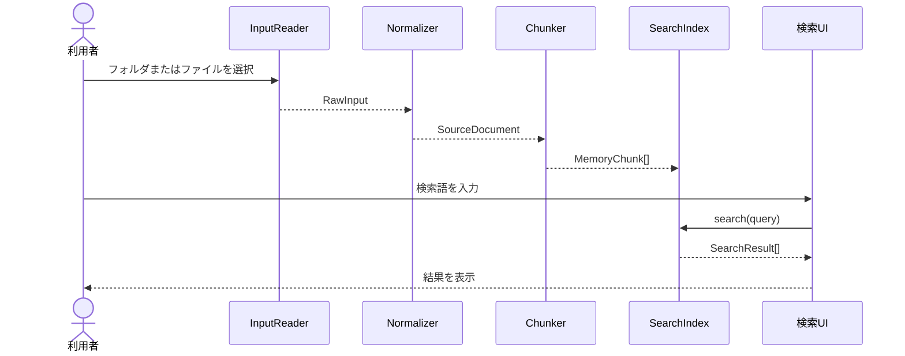

# Local Semantic Memory 詳細設計書（ドラフト）

## 1. 対象範囲

本書は、Markdown入力を正規化し、検索用チャンクを生成し、メモリ上の全文検索インデックスから結果を返すモジュール契約を正本とする。履歴・ブックマーク入力、Embedding、IndexedDB、RRF統合、クラスタリングは後続の設計で定義する。

### 1.1 対象機能

- Markdownフォルダ・ファイルの読み込み
- 日本語3-gram全文検索
- 検索結果の整形
- 入力・検索エラーの分類

### 1.2 対象外

- Web Workerへの処理移行
- Embedding生成と`query:` / `passage:`接頭辞
- IndexedDBへの保存と再利用
- RRFによるハイブリッド検索
- Topicクラスタリングと月次グラフ
- Node.js、Bun、npmを使ったビルド・テスト実行

## 2. モジュールInterface

### 2.0 Phase 1データ型

```text
RawFile = {
  path: string,
  title: string,
  body: string,
  updatedAt: number
}

SourceDocument = {
  sourceId: string,
  sourceType: "markdown",
  sourceLocator: string,
  title: string,
  body: string,
  sourceTimestamp: number,
  sourceTimestampKind: "updated",
  sourceHash: string
}

MemoryChunk = {
  chunkId: string,
  sourceId: string,
  ordinal: number,
  body: string,
  contentHash: string,
  charStart: number,
  charEnd: number
}

Result<T, E> = { ok: true, value: T } | { ok: false, error: E }
NormalizeError = "INPUT_FORMAT_INVALID" | "INPUT_RECORD_INVALID" | "DOCUMENT_EMPTY"
SearchOptions = { sourceIds?: string[], updatedAfter?: number, updatedBefore?: number }
```

### 2.1 InputReader

**責務**: 利用者が選択した入力を読み取り、ファイル単位の未加工データを返す。

```text
readMarkdownDirectory(): Promise<RawFile[]>
readDroppedFile(file: File): Promise<RawFile>
```

**契約**:

- 利用者の明示操作なしにファイルを読み取らない。
- `.md`以外のMarkdownフォルダ内ファイルは初期対象外とする。
- 読み取り失敗は`INPUT_READ_FAILED`として返す。
- 入力本文をログへ出力しない。

### 2.2 Normalizer

**責務**: RawFileまたは履歴・ブックマークレコードを検証し、SourceDocumentを生成する。

```text
normalize(raw: RawInput): Result<SourceDocument, NormalizeError>
```

**契約**:

- `sourceId`は`markdown:`と正規化相対パスを連結して安定生成する。
- Phase 1ではMarkdown以外の`sourceType`を受け付けない。
- Markdownの相対パスを正規化し、`javascript:`、`data:`、`file:`などのノイズまたは危険なURLスキームを検索対象から除外する。
- 空タイトルはファイル名から補完し、本文が空の場合は`DOCUMENT_EMPTY`として検索対象外にする。
- 不正レコードは全処理を中断せず、レコード単位で除外して警告へ集計する。

### 2.3 Chunker

**責務**: SourceDocumentの本文を検索単位へ分割する。

```text
chunk(source: SourceDocument): Promise<MemoryChunk[]>
```

**契約**:

- Markdown見出しを優先的な分割位置とする。
- 1チャンクの目安は500文字前後とする。
- 長い段落は文字境界で分割する。
- `ordinal`はSourceDocumentごとの0始まり連番とする。
- `chunkId`は`sourceId + ordinal`から決定的に生成する。
- 空白だけのチャンクは生成しない。
- `contentHash`はブラウザの`crypto.subtle.digest("SHA-256", ...)`で算出するため、ChunkerはPromiseを返す。
- 同一入力に対して同じ順序・同じ本文を返す。

### 2.4 SearchIndex

**責務**: MemoryChunkの登録、削除、検索をメモリ上で行う。

```text
SearchEntry = {
  chunk: MemoryChunk,
  source: SourceDocument
}

create(): SearchIndex
add(entries: SearchEntry[]): void
clear(): void
search(query: string, options?: SearchOptions): SearchResult[]
```

**契約**:

- Phase 1ではIndexedDBや外部サービスへアクセスしない。
- 登録対象は`source.title`、`chunk.body`、`source.sourceLocator`を連結した検索テキストとする。
- 日本語検索は3-gramを基本とする。検索語が2文字以下の場合は2-gramへフォールバックし、1文字の場合は正規化済みの部分一致へフォールバックする。
- ASCII単語は小文字化し、Unicode正規化を適用する。
- 結果はスコア降順、同点時は`sourceTimestamp`降順、さらに`chunkId`昇順で安定ソートする。
- 空検索語は検索せず、利用者へ入力を促す。
- 初期のメモリ上限は50,000チャンクとし、超過時は`INDEX_SIZE_LIMIT`を返す。

### 2.5 SearchResult

| フィールド        | 型     | 必須  | 内容                            |
| :---------------- | :----- | :---: | :------------------------------ |
| `chunkId`         | string | 必須  | MemoryChunkの識別子             |
| `sourceId`        | string | 必須  | SourceDocumentの識別子          |
| `title`           | string | 必須  | 表示用タイトル                  |
| `snippet`         | string | 必須  | 一致箇所を含む本文抜粋          |
| `sourceLocator`   | string | 必須  | 表示用の相対パスまたはURL       |
| `sourceTimestamp` | number | 必須  | 元データの時刻                  |
| `score`           | number | 必須  | 3-gram一致に基づくPhase 1スコア |

## 3. 制御フロー



### 3.1 初期化

1. UIがInputReaderへ読み込みを依頼する。
2. 入力ごとにNormalizerを実行する。
3. 正常なSourceDocumentをChunkerへ渡す。
4. MemoryChunkをSearchIndexへ登録する。
5. 除外件数とエラー分類をUIへ通知する。

### 3.2 再読み込み

- Phase 1では永続化データを使用しない。
- リロード後はSearchIndexを空で初期化する。
- 利用者が再度入力を選択した時点で、初期化フローを最初から実行する。
- 既存画面に古い検索結果を残さない。

## 4. エラー分類

| コード                 | 種別   | 発生条件                         | UIの扱い                         |
| :--------------------- | :----- | :------------------------------- | :------------------------------- |
| `INPUT_READ_FAILED`    | 入力   | ファイル読み取りに失敗           | 対象ファイル名と再試行を表示     |
| `DOCUMENT_EMPTY`       | 正規化 | 本文が空                         | 対象Documentを検索対象外にする   |
| `INPUT_FORMAT_INVALID` | 入力   | Markdownファイル全体の形式が不正 | 対象ファイルを除外し通知する     |
| `INPUT_RECORD_INVALID` | 入力   | 必須フィールド不足               | 対象レコードを除外し警告表示     |
| `INDEX_SIZE_LIMIT`     | 検索   | 50,000チャンク超過               | 絞り込み条件を要求する           |
| `QUERY_EMPTY`          | 検索   | 検索語が空                       | 検索を実行せず入力を促す         |
| `SEARCH_FAILED`        | 検索   | インデックス処理に失敗           | 再構築を案内しデータを破棄しない |

エラー表示には本文、完全URL、検索語を含めない。開発用の詳細情報を追加する場合も、絶対パスや入力本文を記録しない。

## 5. 非機能目標（初期値）

| ID      | 目標         | 暫定値                                                    | 測定方法                        |
| :------ | :----------- | :-------------------------------------------------------- | :------------------------------ |
| NFR-001 | 初期検索応答 | 50,000チャンク以内で通常検索の結果を1秒以内に返す         | ブラウザのPerformance APIで計測 |
| NFR-002 | UI応答性     | 10,000チャンクまで初期登録中に操作不能時間を2秒以内にする | ブラウザ上で計測                |
| NFR-003 | データ保全   | 検索失敗で入力済みチャンクを破棄しない                    | エラー時の状態確認              |
| NFR-004 | ブラウザ     | File System Access APIを使えるChromium系を初期対象とする  | 対応ブラウザで確認              |

## 6. Phase 1の完了条件

- 利用者がMarkdownフォルダを選択できる。
- Markdownファイルを`SourceDocument`へ正規化できる。
- SourceDocumentの`body`をMemoryChunkへ非同期分割し、SHA-256の`contentHash`を設定できる。
- 日本語3-gramを含むメモリ上の全文検索で結果を返せる。
- 2文字以下の検索語にもフォールバック方式で結果を返せる。
- リロード時に入力データから検索インデックスを再構築できる。
- 不正入力や検索エラーを利用者へ分類表示できる。

## 7. 後続設計への引継ぎ

- Web Workerへの処理移行
- Embedding生成と`query:` / `passage:`接頭辞
- IndexedDBへの保存と再利用
- RRFによるハイブリッド検索
- Topicクラスタリング、トピック命名、月次グラフ
- Node.js、Bun、npmを使ったビルド・テスト実行
