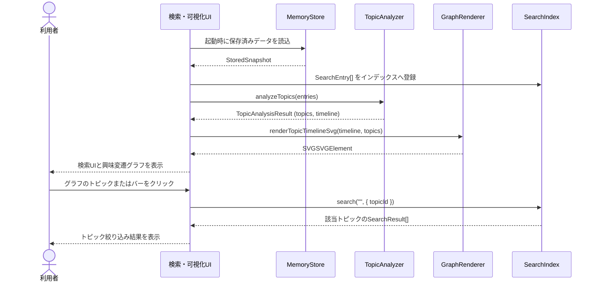

# Local Semantic Memory 詳細設計書（ドラフト）

## 1. 対象範囲

本書は、Markdown・履歴・ブックマーク入力の正規化、検索用チャンク生成、Embedding生成、IndexedDBへの差分保存、キーワード順位とベクトル順位を統合するReciprocal Rank Fusion（RRF）ハイブリッド検索、およびEmbeddingに基づくトピッククラスタリング・命名と月次興味変遷グラフの描画モジュール契約を正本とする。

### 1.1 対象機能

- Markdownフォルダの読み込み（フォルダ内の`.md`ファイル）
- 履歴・ブックマークエクスポートファイル（JSON / HTML）および単一Markdownファイルの読み込み
- 相対パス検証および履歴・ブックマークのURLスキーム除外
- 見出し・文字数単位のチャンク分割とSHA-256ハッシュ算出
- `passage: ` / `query: `接頭辞を付与するEmbedding生成
- IndexedDBおよびインメモリストアによる`SourceDocument`・`MemoryChunk`・`EmbeddingCache`の差分保存と再利用
- 日本語3-gram・2-gram全文検索とコサイン類似度ベクトル検索のRRFハイブリッド検索
- チャンクEmbeddingに基づくブラウザ内トピッククラスタリング（Phase 3）
- クラスタ代表語・頻出語からの自動トピック命名（Phase 3）
- `sourceTimestamp`と`sourceTimestampKind`に基づく月次興味変遷集計（Phase 3）
- 外部依存なしのSVGによるインタラクティブな興味変遷グラフ描画（Phase 3）
- 入力、正規化、Embedding、永続化、検索、トピック解析で発生するエラーの分類と状態保全

### 1.2 対象外

- 外部サーバーとのデータ同期・利用者認証
- サーバー側での重いGPU推論

## 2. モジュールInterface

### 2.0 データ型

| 型名                   | 主なフィールド・定義                                                                                                               |
| :--------------------- | :--------------------------------------------------------------------------------------------------------------------------------- |
| `SourceType`           | `"markdown"` / `"history"` / `"bookmark"`                                                                                          |
| `RawFile`              | `path`, `title`, `body`, `updatedAt`, `sourceType?`, `sourceTimestampKind?`                                                        |
| `SourceDocument`       | `sourceId`, `sourceType`, `sourceLocator`, `title`, `body`, `sourceTimestamp`, `sourceTimestampKind`, `sourceHash`, `schemaVersion` |
| `MemoryChunk`          | `chunkId`, `sourceId`, `ordinal`, `body`, `contentHash`, `charStart`, `charEnd`, `schemaVersion`                                   |
| `EmbeddingCache`       | `chunkId`, `modelId`, `dimensions`, `vector`, `generatedAt`                                                                        |
| `SearchEntry`          | `chunk`, `source`, `embedding?`                                                                                                    |
| `Topic`                | `topicId`, `label`, `algorithmVersion`, `createdAt`                                                                                |
| `TopicAssignment`      | `assignmentId`, `chunkId`, `topicId`, `score`                                                                                      |
| `MonthlyTopicCount`    | `month`, `counts`, `total`                                                                                                         |
| `TopicAnalysisResult`  | `topics`, `assignments`, `timeline`                                                                                                |
| `SearchOptions`        | `sourceIds?`, `sourceTypes?`, `updatedAfter?`, `updatedBefore?`, `queryVector?`, `rrfK?`, `topicId?`                                |
| `Result<T, E>`         | `{ ok: true, value: T }` または `{ ok: false, error: E }`                                                                          |
| `NormalizeError`       | `"PATH_INVALID"` / `"URL_EXCLUDED"` / `"DOCUMENT_EMPTY"`                                                                           |
| `EmbeddingError`       | `"EMBEDDING_EMPTY"` / `"EMBEDDING_INVALID_VECTOR"` / `"EMBEDDING_FAILED"`                                                          |
| `StoreError`           | `"STORE_READ_FAILED"` / `"STORE_WRITE_FAILED"` / `"STORE_CLEAR_FAILED"`                                                            |
| `IndexError`           | `"INDEX_SIZE_LIMIT"` / `"INDEX_BUILD_FAILED"`                                                                                      |
| `SearchError`          | `"QUERY_EMPTY"` / `"SEARCH_FAILED"`                                                                                                |
| `TopicError`           | `"TOPIC_INSUFFICIENT_DATA"` / `"TOPIC_ANALYSIS_FAILED"`                                                                            |

### 2.1 InputReader

**責務**: 利用者が選択またはドロップした入力を読み取り、ファイル・レコード単位の未加工データを返す。

- `readMarkdownDirectory(directory: FileSystemDirectoryHandle): Promise<InputReadResult>`
- `parseStructuredExport(fileName: string, content: string, fallbackUpdatedAt?: number): Result<RawFile[], FileReadError>`
- `readInputFiles(files: Iterable<File>): Promise<RawFileBatch>`

### 2.2 Normalizer

**責務**: RawFileを検証し、SourceDocumentを生成する。

- `normalize(raw: RawFile, hasher: Hasher): Promise<Result<SourceDocument, NormalizeError>>`

### 2.3 Chunker

**責務**: SourceDocumentの本文を検索単位へ分割する。

- `chunk(source: SourceDocument, hasher: Hasher): Promise<MemoryChunk[]>`

### 2.4 EmbeddingProvider

**責務**: チャンク本文および検索クエリからEmbeddingベクトルを生成する。

- `embedPassage(text: string): Promise<Result<number[], EmbeddingError>>`
- `embedQuery(text: string): Promise<Result<number[], EmbeddingError>>`

### 2.5 MemoryStore

**責務**: `SourceDocument`、`MemoryChunk`、`EmbeddingCache`の永続化、差分更新、全削除を担う。

- `loadAll(): Promise<Result<StoredSnapshot, StoreError>>`
- `saveBatch(snapshot: StoredSnapshot): Promise<Result<void, StoreError>>`
- `deleteSource(sourceId: string): Promise<Result<void, StoreError>>`
- `clearAll(): Promise<Result<void, StoreError>>`
- `syncRawFilesToStore(rawFiles: RawFile[], store: MemoryStore, hasher: Hasher, embeddingProvider: EmbeddingProvider): Promise<Result<SyncSummary, StoreError>>`

### 2.6 SearchIndex

**責務**: MemoryChunkとEmbeddingの登録、削除、キーワード検索およびRRFハイブリッド検索をメモリ上で行う。

- `create(): SearchIndex`
- `add(entries: SearchEntry[]): Result<void, IndexError>`
- `clear(): void`
- `search(query: string, options?: SearchOptions): Result<SearchResult[], SearchError>`

**契約**:

- `options.queryVector`が指定された場合、キーワード順位とコサイン類似度ベクトル順位をRRF（既定`k = 60`）で統合する。
- `options.topicId`が指定された場合、指定トピックに所属するチャンクのみへ結果を絞り込む。

### 2.7 TopicAnalyzer（Phase 3）

**責務**: チャンクのEmbeddingベクトルをクラスタリングし、代表トピック名を付与し、月次タイムラインを集計する。

- `analyzeTopics(entries: SearchEntry[], options?: TopicOptions): Result<TopicAnalysisResult, TopicError>`

**契約**:

- チャンク件数が0件の場合は`TOPIC_INSUFFICIENT_DATA`を返す。
- 各チャンクのEmbeddingベクトル間のコサイン距離または類似度に基づき、ブラウザ内で完結するクラスタリング（リーダー・フォロワー法またはコサイン類似度閾値クラスタリング、目標クラスタ数3〜8個）を行う。
- 各クラスタの所属チャンクのタイトル、見出し、本文の頻出語（名詞・カタカナ語・重要2-3gram）から代表語を抽出し、トピックの`label`（例: 「設計・アーキテクチャ」「AI・機械学習」等）を決定する。
- クラスタ所属度として`score`（クラスタ重心とのコサイン類似度）を算出し、`TopicAssignment`を生成する。
- `sourceTimestamp`（Unixミリ秒）を`YYYY-MM`形式の月次キーへマッピングし、月別・トピック別のチャンク出現数を集計して`MonthlyTopicCount[]`を返す。
- 処理に失敗しても既存のインデックスやストアのデータを破壊しない。

### 2.8 GraphRenderer（Phase 3）

**責務**: 月次トピック推移データから外部ライブラリ非依存のSVG興味変遷グラフを生成し、DOMへ描画する。

- `renderTopicTimelineSvg(timeline: MonthlyTopicCount[], topics: Topic[], onSelectTopic?: (topicId: string | null) => void): SVGSVGElement`

**契約**:

- 外部ライブラリ（Chart.js、D3等）を読み込まず、ブラウザ標準のSVG DOM APIまたは純粋なSVG文字列生成で描画する。
- X軸に月次（`YYYY-MM`）、Y軸に出現チャンク数（または比率）をスタック棒グラフまたは積み上げ面グラフとして表示する。
- トピックごとに識別しやすいアクセシブルなカラーパレットを割り当て、トピック名凡例を表示する。
- 凡例またはバー要素をクリックした際、`onSelectTopic(topicId)`コールバックを呼び出し、該当トピックのチャンク一覧への検索絞り込みを可能にする。

## 3. 制御フロー

## 4. エラー分類

| コード                     | 種別      | 発生条件                     | UIの扱い                                 |
| :------------------------- | :-------- | :--------------------------- | :--------------------------------------- |
| `DIRECTORY_READ_FAILED`    | 入力      | ディレクトリ列挙に失敗       | 読み込みを終了し再試行を表示             |
| `FILE_READ_FAILED`         | 入力      | 個別ファイルの読取・解析失敗 | 対象ファイル名を表示し他ファイルを継続   |
| `PATH_INVALID`             | 正規化    | 親参照・絶対パスなどを検出   | 対象ファイルを除外し通知する             |
| `URL_EXCLUDED`             | 正規化    | 非HTTP/HTTPSや不正URLを検出  | 対象レコードを除外し通知する             |
| `DOCUMENT_EMPTY`           | 正規化    | 本文が空                     | 対象Documentを検索対象外にする           |
| `EMBEDDING_EMPTY`          | Embedding | 空テキストのベクトル化要求   | 対象チャンクのベクトル生成をスキップ     |
| `EMBEDDING_INVALID_VECTOR` | Embedding | 次元不一致または非有限値     | 更新前の状態を維持しエラーを通知         |
| `EMBEDDING_FAILED`         | Embedding | モデル推論またはWorker失敗   | 更新前の状態を維持しエラーを通知         |
| `STORE_READ_FAILED`        | 永続化    | IndexedDBからの読込失敗      | メモリインデックスで継続し警告を表示     |
| `STORE_WRITE_FAILED`       | 永続化    | IndexedDBへの保存失敗        | 既存データを維持し再試行を案内           |
| `STORE_CLEAR_FAILED`       | 永続化    | IndexedDBの全削除失敗        | エラーを表示し再試行を案内               |
| `INDEX_SIZE_LIMIT`         | 検索      | 50,000チャンク超過           | フォルダまたは登録対象を絞って再実行する |
| `INDEX_BUILD_FAILED`       | 検索      | インデックス登録に失敗       | 更新前の状態を保持し再試行を案内         |
| `QUERY_EMPTY`              | 検索      | 検索語が空                   | 検索を実行せず入力を促す                 |
| `SEARCH_FAILED`            | 検索      | 検索処理に失敗               | インデックスを破棄せず再構築を案内       |
| `TOPIC_INSUFFICIENT_DATA`  | トピック  | 分析対象チャンクが不足       | グラフ描画をスキップしデータ投入を促す   |
| `TOPIC_ANALYSIS_FAILED`    | トピック  | クラスタリング・集計処理失敗 | 既存の検索機能を維持しエラーを表示       |

## 5. 非機能目標

| ID      | 目標         | 暫定値                                                    | 測定方法                        |
| :------ | :----------- | :-------------------------------------------------------- | :------------------------------ |
| NFR-001 | 初期検索応答 | 50,000チャンク以内で通常検索の結果を1秒以内に返す         | ブラウザのPerformance APIで計測 |
| NFR-002 | UI応答性     | 10,000チャンクまで初期登録中に操作不能時間を2秒以内にする | ブラウザ上で計測                |
| NFR-003 | トピック解析 | 5,000チャンクのクラスタリングと集計を1秒以内で完了する    | Performance APIで計測           |
| NFR-004 | グラフ描画   | SVGグラフの初回描画およびインタラクション応答100ms以内    | Performance APIで計測           |

## 6. Phase 3の完了条件

- チャンクのEmbeddingベクトルからブラウザ内でトピッククラスタリングを実行できる。
- 各クラスタに代表的なトピック名（ラベル）を自動抽出・命名できる。
- `sourceTimestamp`（更新日時・閲覧日時）に基づいて月別のトピック出現推移を集計できる。
- SVGによる興味変遷グラフ（タイムライン・スタックバー）を描画し、月別・トピック別の関心の変化を確認できる。
- グラフやトピック選択に連動して検索結果の絞り込みができる。
