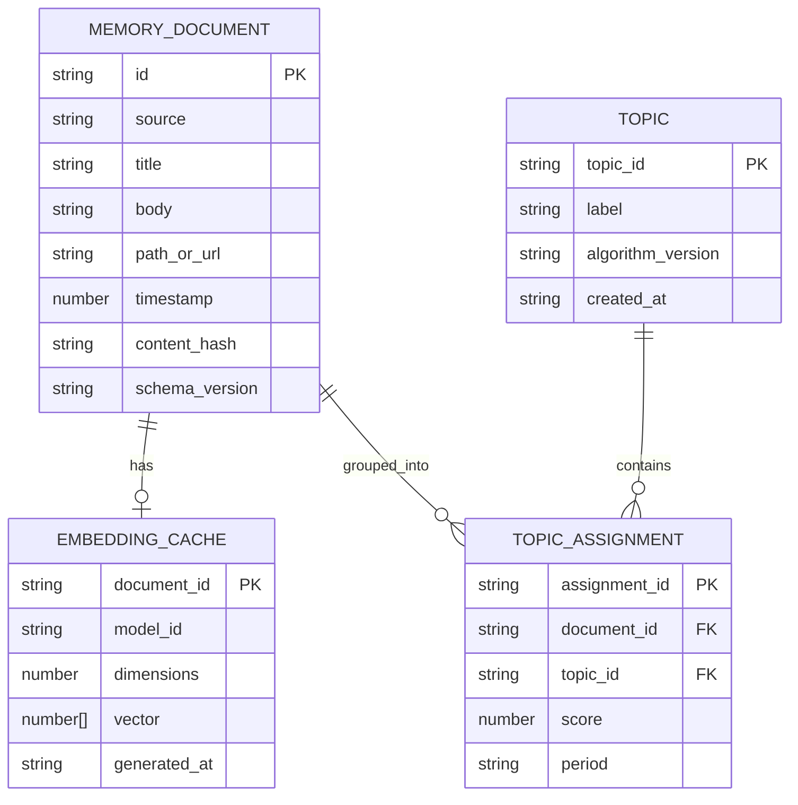

# Local Semantic Memory データ構造仕様書（ドラフト）

## 1. データ管理方針

- **保存先**: ブラウザのIndexedDB。サーバー、ローカルファイル、Cookieには保存しない。
- **文字コード**: 入力・表示ともUTF-8として扱う。
- **時刻**: Unix epoch millisecondsを基本値とし、表示時に利用者のローカル時刻へ変換する。
- **機密性**: 入力本文、URL、検索語、Embeddingを外部へ送信しない。IndexedDBの暗号化はブラウザ標準機能に依存しないため、端末共有時のプロファイル管理を利用者責任とする。
- **再構築**: スキーマ変更またはモデル変更時に、保存データを削除して再インデックスできる。

## 2. エンティティ構造

## 3. フィールド仕様

### 3.1 MemoryDocument

| フィールド | 型 | 必須 | 制約 |
| :--- | :--- | :---: | :--- |
| `id` | string | 必須 | コンテンツまたは正規化済みレコードのSHA-256。重複不可 |
| `source` | enum | 必須 | `markdown`、`history`、`bookmark`のいずれか |
| `title` | string | 必須 | 空文字不可。表示用タイトル |
| `body` | string | 必須 | 検索対象のチャンク本文。空文字不可 |
| `pathOrUrl` | string | 必須 | Markdownの相対パスまたは履歴・ブックマークのURL |
| `timestamp` | number | 必須 | Unix epoch milliseconds。負数不可 |
| `contentHash` | string | 必須 | チャンク内容のSHA-256。差分更新に使用 |
| `schemaVersion` | string | 必須 | 保存スキーマのバージョン。初版は`1` |

### 3.2 EmbeddingCache

| フィールド | 型 | 必須 | 制約 |
| :--- | :--- | :---: | :--- |
| `documentId` | string | 必須 | `MemoryDocument.id`に対応 |
| `modelId` | string | 必須 | モデル名とバージョンを含む識別子 |
| `dimensions` | number | 必須 | ベクトル長と一致。候補モデルでは384を想定 |
| `vector` | number[] | 必須 | `dimensions`と同じ長さ。有限値のみ |
| `generatedAt` | string | 必須 | ISO 8601形式 |

### 3.3 Topic / TopicAssignment

- `Topic.topicId`はクラスタリング実行ごとに安定性を保証しない。アルゴリズムまたは入力範囲が変わる場合は、`algorithmVersion`を更新する。
- `TopicAssignment.score`は所属度または距離から算出した評価値で、算出方法はDDで定義する。
- `TopicAssignment.period`は`YYYY-MM`形式とし、月次推移集計のキーに使用する。

## 4. IndexedDB構成

- **データベース名**: `local-semantic-memory`
- **初期スキーマバージョン**: `1`
- **Object Store**:
  - `documents`: keyPath `id`。`source`、`timestamp`、`contentHash`にインデックスを作成する。
  - `embeddings`: keyPath `documentId`。`modelId`にインデックスを作成する。
  - `topics`: keyPath `topicId`。
  - `assignments`: keyPath `assignmentId`。`documentId`、`topicId`、`period`にインデックスを作成する。
- **トランザクション**: 1回のインデックス更新で、対象DocumentとEmbeddingの更新を同一トランザクションとして扱う。
- **失敗時**: トランザクション失敗時は更新前の状態を維持し、再試行または対象データだけの再構築を選択できるようにする。

## 5. 差分更新と互換性

1. 入力レコードを正規化し、`contentHash`を算出する。
2. 同じ`id`と`contentHash`の保存済みDocumentは再登録しない。
3. 本文またはメタデータが変わったDocumentは、Embeddingを再利用せず再計算対象にする。
4. `modelId`が変わった場合は、既存Embeddingを旧モデルのキャッシュとして残すか削除し、現行モデルで再生成する。
5. `schemaVersion`が変わる場合は、新しいObject Storeまたは明示的な移行処理を使用する。暗黙のフィールド解釈変更は禁止する。

## 6. 削除とプライバシー

- 利用者は全データ削除を実行できる。
- Document削除時は対応するEmbeddingとTopicAssignmentも削除する。
- 入力元ファイルの削除や移動は自動追跡しない。次回同期時に利用者が再インデックスを実行する。
- ログには本文、URL、検索語、Embeddingを出力しない。
