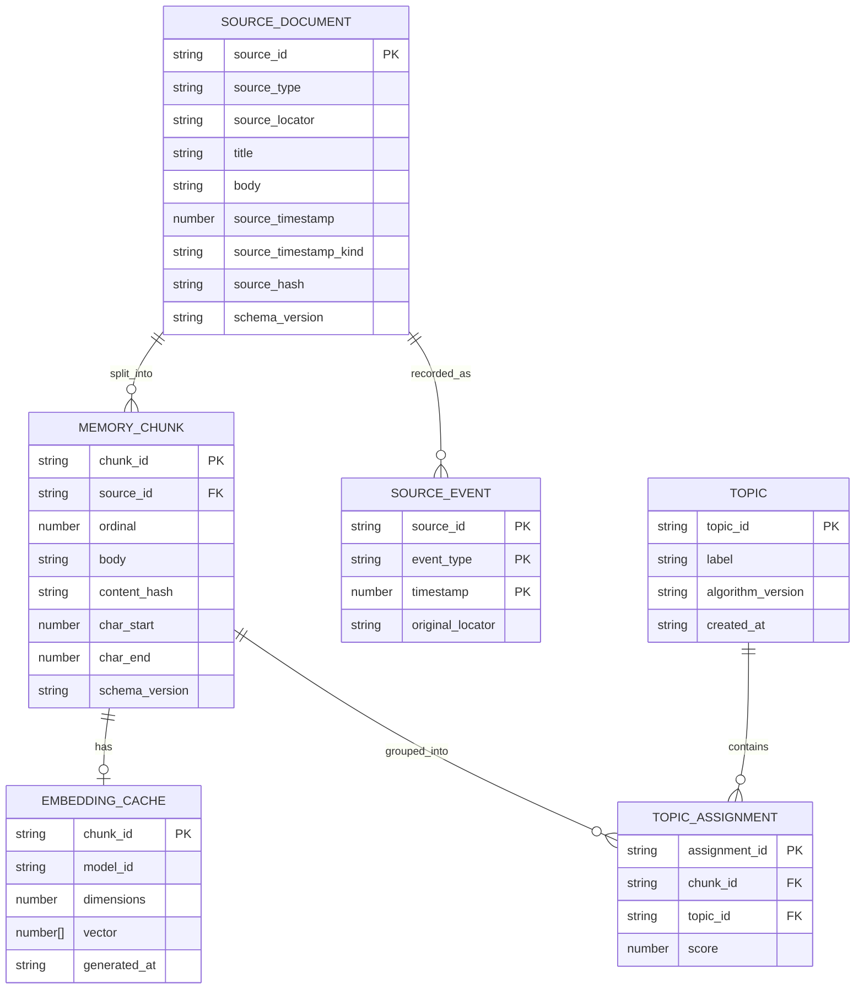

# Local Semantic Memory データ構造仕様書（ドラフト）

## 1. データ管理方針

- **保存先**: Phase 1はメモリ上だけで扱い、リロード時に再構築する。Phase 2以降はブラウザのIndexedDBへ保存する。
- **文字コード**: 入力・表示ともUTF-8として扱う。
- **時刻**: Unix epoch millisecondsを基本値とし、表示時に利用者のローカル時刻へ変換する。
- **機密性**: 入力本文、URL、検索語、Embeddingを外部へ送信しない。IndexedDBの暗号化はブラウザ標準機能に依存しないため、端末共有時のプロファイル管理を利用者責任とする。
- **再構築**: スキーマ変更またはモデル変更時に、保存データを削除して再インデックスできる。

## 2. エンティティ構造

`SourceDocument`は入力元単位（履歴・ブックマークは正規化URL単位）、`MemoryChunk`は検索・Embedding単位、`SourceEvent`は入力元に対する訪問・登録・更新の1回分の記録である。チャンク本文の同一性と、入力元・位置の同一性を分離することで、異なるファイルに同じ本文が存在しても衝突しない。コンテンツ（`SourceDocument`・`MemoryChunk`・`EmbeddingCache`）とイベント（`SourceEvent`）を分離する判断理由はADR-002を参照する。

## 3. フィールド仕様

### 3.1 SourceDocument

| フィールド            | 型     | 必須  | 制約                                                                                                                                     |
| :-------------------- | :----- | :---: | :--------------------------------------------------------------------------------------------------------------------------------------- |
| `sourceId`            | string | 必須  | Markdownは`markdown:`と正規化相対パス、履歴は`history:`と正規化URL、ブックマークは`bookmark:`と正規化URLから生成する安定識別子。重複不可 |
| `sourceType`          | enum   | 必須  | `markdown`、`history`、`bookmark`のいずれか                                                                                              |
| `sourceLocator`       | string | 必須  | Markdownの相対パスまたは履歴・ブックマークの正規化URL                                                                                    |
| `title`               | string | 必須  | 空文字不可。表示用タイトル                                                                                                               |
| `body`                | string | 必須  | 入力元の本文。履歴・ブックマークは「タイトル + URLのホストとパス」。Chunkerがこの本文を検索用チャンクへ分割する                          |
| `sourceTimestamp`     | number | 必須  | 最終イベント時刻（Unix epoch milliseconds）。取り込みのたびに、対象の`SourceEvent`のうち最大の`timestamp`で更新する。負数不可            |
| `sourceTimestampKind` | enum   | 必須  | 最終イベントの`eventType`。`updated`（Markdown更新）、`visited`（履歴閲覧）、`created`（ブックマーク登録）                               |
| `sourceHash`          | string | 必須  | `sourceLocator`、改行、本文を連結した値のSHA-256。時刻は含めない。ファイル移動も変更として検出する                                       |
| `schemaVersion`       | string | 必須  | 保存スキーマのバージョン。初版は`1`                                                                                                      |

履歴・ブックマークは、同一の正規化URLを1件の`SourceDocument`として保持する。同一URLへの複数回の訪問は`SourceEvent`として個別に保持し、`SourceDocument`には複製しない。URLの正規化規則は詳細設計書（DD）で定義する。`sourceTimestamp`は`sourceHash`の入力に含めないため、時刻の更新だけではチャンクとEmbeddingを再生成しない。

Markdownの同一性は正規化相対パスで決まる。ファイルの移動・リネームは別の`SourceDocument`として扱い、追跡しない。

### 3.2 MemoryChunk

| フィールド              | 型     | 必須  | 制約                                                  |
| :---------------------- | :----- | :---: | :---------------------------------------------------- |
| `chunkId`               | string | 必須  | `sourceId + ordinal`から生成する安定キー。重複不可    |
| `sourceId`              | string | 必須  | `SourceDocument.sourceId`への参照                     |
| `ordinal`               | number | 必須  | SourceDocument内の0始まりのチャンク順序               |
| `body`                  | string | 必須  | 検索対象のチャンク本文。空文字不可                    |
| `contentHash`           | string | 必須  | チャンク本文と検索用メタデータのSHA-256。差分判定専用 |
| `charStart` / `charEnd` | number | 必須  | 元本文における文字範囲。`charStart < charEnd`         |
| `schemaVersion`         | string | 必須  | 保存スキーマのバージョン                              |

### 3.3 EmbeddingCache

| フィールド    | 型       | 必須  | 制約                                      |
| :------------ | :------- | :---: | :---------------------------------------- |
| `chunkId`     | string   | 必須  | `MemoryChunk.chunkId`に対応               |
| `modelId`     | string   | 必須  | モデル名とバージョンを含む識別子          |
| `dimensions`  | number   | 必須  | ベクトル長と一致。候補モデルでは384を想定 |
| `vector`      | number[] | 必須  | `dimensions`と同じ長さ。有限値のみ        |
| `generatedAt` | string   | 必須  | ISO 8601形式                              |

multilingual-e5系を採用する場合、EmbeddingProviderが文書入力へ`passage: `、検索入力へ`query: `を付与する。呼び出し側は接頭辞を直接付与しない。

### 3.4 SourceEvent

| フィールド        | 型     | 必須  | 制約                                                                               |
| :---------------- | :----- | :---: | :--------------------------------------------------------------------------------- |
| `sourceId`        | string | 必須  | `SourceDocument.sourceId`への参照                                                  |
| `eventType`       | enum   | 必須  | `updated`（Markdown更新）、`visited`（履歴閲覧）、`created`（ブックマーク登録）    |
| `timestamp`       | number | 必須  | イベント発生時刻（Unix epoch milliseconds）。負数不可                              |
| `originalLocator` | string | 任意  | 正規化前のURL。Markdownでは持たない。URL正規化規則を見直した場合の再計算に使用する |

- 主キーは`(sourceId, eventType, timestamp)`の複合キーとする。同じキーのイベントを保存した場合は上書きとなり、再取り込みで重複しない。
- `SourceEvent`は追記専用とし、利用者操作による編集は提供しない。
- 参照先の`SourceDocument`が削除されても、`SourceEvent`は削除しない。この場合、集計ではトピックを「不明」として扱う。

### 3.5 Topic / TopicAssignment

- `Topic.topicId`はクラスタリング実行ごとに安定性を保証しない。アルゴリズムまたは入力範囲が変わる場合は、`algorithmVersion`を更新する。
- `TopicAssignment.score`は所属度または距離から算出した評価値で、算出方法は後続の詳細設計書（DD）で定義する。
- 期間は`TopicAssignment`へ重複保存しない。月次期間は、`SourceEvent`の`timestamp`から集計時に導出する。
- `SourceEvent`は、参照先`SourceDocument`のChunkに対する`TopicAssignment.score`の合計が最大のトピックを代表トピックとして、そのトピックに1件として数える。決定方法は詳細設計書（DD）で定義する。

## 4. IndexedDB構成（Phase 2以降）

- **データベース名**: `local-semantic-memory`
- **スキーマバージョン**: `2`（初期は`1`。`events`ストアの追加で`2`へ更新）
- **Object Store**:
  - `sourceDocuments`: keyPath `sourceId`。`sourceType`、`sourceTimestamp`、`sourceHash`にインデックスを作成する。
  - `chunks`: keyPath `chunkId`。`sourceId`、`contentHash`にインデックスを作成する。
  - `embeddings`: keyPath `chunkId`。`modelId`にインデックスを作成する。
  - `events`: keyPath `[sourceId, eventType, timestamp]`。`timestamp`、`sourceId`にインデックスを作成する。
  - `topics`: keyPath `topicId`。
  - `assignments`: keyPath `assignmentId`。`chunkId`、`topicId`にインデックスを作成する。
- **トランザクション**: SourceDocument・Chunk・Embedding・SourceEventの更新は、対象入力単位で同一トランザクションとして扱う。
- **v1→v2移行**: `onupgradeneeded`で`events`ストアを空で作成する。履歴（`sourceType=history`）由来の`sourceDocuments`・`chunks`・`embeddings`を削除する。Markdownとブックマークのデータは保持する。履歴は元のエクスポートファイルから再取り込みして復元する。
- **失敗時**: トランザクション失敗時は更新前の状態を維持し、再試行または対象データだけの再構築を選択できるようにする。
- **ベクトル検索上限**: ベクトル検索対象が50,000チャンクを超える場合は、期間・ソース・検索条件で絞り込んでからEmbeddingを読み込む。

## 5. 差分更新と互換性

1. 入力元を正規化し、`sourceHash`を算出する。
2. 同じ`sourceId`と`sourceHash`の保存済みSourceDocumentは再分割しない。
3. 本文またはチャンク境界が変わった場合は、Chunkの`contentHash`を再計算する。
4. 同じ`chunkId`と`contentHash`のChunkはEmbeddingを再利用できる。
5. `modelId`が変わった場合は、現行モデルでEmbeddingを再生成する。
6. `schemaVersion`が変わる場合は、新しいObject Storeまたは明示的な移行処理を使用する。暗黙のフィールド解釈変更は禁止する。
7. `SourceEvent`は取り込みのたびに全件を保存する。複合キーが同じイベントは上書きされ、重複しない。保存済みの最新`timestamp`による読み飛ばしは行わない。
8. 取り込み後、対象`SourceDocument`の`sourceTimestamp`と`sourceTimestampKind`を、最新の`SourceEvent`で更新する。

## 6. 削除とプライバシー

- 利用者は全データ削除を実行できる。
- SourceDocument削除時は対応するChunk、Embedding、TopicAssignmentも削除する。`SourceEvent`は行動記録として残す。
- 全データ削除では、`SourceEvent`を含むすべてのObject Storeを削除する。
- Event数の上限と、古いEventの集約は設けない。
- 入力元ファイルの削除や移動は自動追跡しない。次回同期時に利用者が再インデックスを実行する。
- ログには本文、URL、検索語、Embeddingを出力しない。
